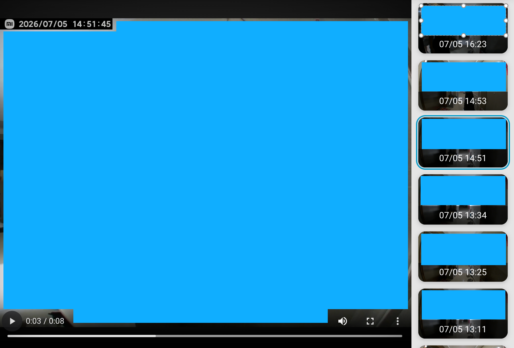

# Gallery Card 2026

[English](README.md) | [中文](README.zh-CN.md)

Home Assistant Lovelace custom card for browsing images and videos from media sources, file-list sensors, and camera entities.

This project is a fork adapted for a more gallery-like layout, date filtering, lazy thumbnails, loading states, and mobile-friendly navigation.

## Preview



## Current Features

- Designed as a full dashboard page first (it fills the viewport below the header), and also works as a regular card with `height: auto`.
- The preview is sized to the media: on wide screens it takes the width the video or image needs at full height, and the timeline gets the rest (more columns on wide screens). Thumbnails use the same ratio, so 4:3 recordings are never cropped or squeezed.
- An info bar at the top of the timeline (never on top of the picture) shows the title, capture time, relative time ("3 分钟前"), position, and slideshow, download, full-screen, and reload actions.
- Timeline of thumbnails grouped by day with sticky day headers ("今天 · 10月21日") and per-day counts; dated items are labeled by time.
- Quick date chips (全部 / 今天 / 昨天 / pick a date) instead of a bare date input.
- Full-screen viewer for images, videos, and cameras with a thumbnail filmstrip, swipe to navigate, swipe down to close, pinch, wheel, or double-tap zoom, and drag to pan.
- Thumbnail list on the right, left, top, bottom, hidden, or responsive layout. On phones the preview stays pinned at the top while the timeline scrolls below it.
- Supports images, videos, Home Assistant camera entities, `media-source://` paths, and file-list sensor attributes.
- Lazy thumbnail loading with media URLs resolved only when thumbnails enter view, and more items loaded automatically while scrolling.
- Video duration badges and a dot on items from the last hour.
- Touch swipe and keyboard arrow navigation; follows the Home Assistant theme in light and dark mode.

## Installation

Build output is `gallery-card.js` in the project root. Put that file where Home Assistant can serve it, for example:

```text
/config/www/community/gallery-card/gallery-card.js
```

Then add the Lovelace resource:

```yaml
url: /local/community/gallery-card/gallery-card.js
type: module
```

Use the card as:

```yaml
type: custom:gallery-card
title: Door Lock
entities:
  - path: media-source://media_source/local
    recursive: true
menu_alignment: right
items_per_page: 12
maximum_files: 100
enable_date_search: true
folder_format: YYYYMMDD
search_date_folder_format: YYYYMMDD
date_search_adjacent_days: 1
file_name_format: YYYYMMDDHHmmss
caption_format: MM/DD HH:mm
show_reload: true
```

## Local Development

Install dependencies:

```bash
npm ci --cache /tmp/gallery-card-2026-npm-cache
```

Build once:

```bash
npm run build
```

Watch source changes:

```bash
npm run watch
```

During development, copy the generated root-level `gallery-card.js` to the Home Assistant resource path and hard-refresh the dashboard.

## Configuration

### Required Source

Use either `entity` or `entities`.

| Name | Type | Default | Description |
|------|------|---------|-------------|
| `entity` | string | none | Single source. Converted internally to `entities`. |
| `entities` | list | none | List of entity ids or media-source objects. |

Entity entries can be strings:

```yaml
entities:
  - sensor.front_door_files
```

Or media-source objects:

```yaml
entities:
  - path: media-source://media_source/local/camera
    recursive: true
    include_images: true
    include_video: true
```

Supported object fields:

| Name | Type | Default | Description |
|------|------|---------|-------------|
| `path` | string | required | Media source path. |
| `recursive` | boolean | `false` | Browse child directories. |
| `include_images` | boolean | `true` | Include image media classes. |
| `include_video` | boolean | `true` | Include video media classes. |
| `folder_format` | string | card value | Override card-level folder format. |
| `file_name_format` | string | card value | Override card-level filename date format. |
| `file_name_date_begins` | number/string | card value | Start position for parsing date from filename. |
| `caption_format` | string | card value | Override card-level caption format. |

### Layout

| Name | Type | Default | Description |
|------|------|---------|-------------|
| `title` | string | none | Title shown in the info bar. On phones the current item's time takes its place. |
| `aspect_ratio` | string/number | `auto` | Preview and thumbnail ratio. `auto` uses the first loaded media (at least 1:1, so portrait items are pillarboxed). Set `"4:3"`, `"16:9"`, or a number to fix it and avoid the one-time adjustment after loading. |
| `height` | string/number | `viewport` | `viewport` fills the screen below the dashboard header (best in a panel view). `auto` sizes to content for use as a regular card. Any CSS length (`600`, `"80vh"`) sets a fixed height. |
| `menu_alignment` | string | `responsive` | `responsive`, `right`, `left`, `bottom`, `top`, or `hidden`. `top` and `bottom` show a horizontal filmstrip. Narrow cards always stack the preview above the timeline. |
| `items_per_page` | number | `10` | Thumbnails loaded per page; more load automatically while scrolling. |
| `show_reload` | boolean | `false` | Show a manual media reload button in the info bar. |

The sizes can also be tuned with CSS variables, for example via card-mod:

| Variable | Default | Description |
|----------|---------|-------------|
| `--gallery-card-height` | `calc(100dvh - var(--header-height))` | Card height when `height` is `viewport`. |
| `--gallery-card-sidebar-width` | `280px` | Minimum timeline width for `responsive`, `left`, and `right`; the timeline also takes any width the preview doesn't need. |
| `--gallery-card-strip-item-width` | `150px` | Thumbnail width in the `top` and `bottom` filmstrips. |

### Limits And Sorting

| Name | Type | Default | Description |
|------|------|---------|-------------|
| `maximum_files` | number | unlimited | `0` means unlimited. |
| `maximum_files_per_entity` | boolean | `true` | Apply `maximum_files` per entity instead of globally. |
| `reverse_sort` | boolean | `true` | Reverse filename/media-title order after sorting. |
| `random_sort` | boolean | `false` | Shuffle resources after loading. |
| `parsed_date_sort` | boolean | `false` | Sort by parsed date from `file_name_format`. |

### Date And Caption Parsing

Old strftime-like tokens such as `%Y`, `%m`, `%d`, `%H`, `%M`, `%S` are converted to Day.js-style tokens internally.

| Name | Type | Default | Description |
|------|------|---------|-------------|
| `enable_date_search` | boolean | `false` | Show the date chips (全部 / 今天 / 昨天 / pick a date) and filter by the selected day. |
| `search_date_folder_format` | string | `DD_MM_YYYY` | Folder name format used when recursively filtering date folders. |
| `date_search_adjacent_days` | number | `1` | Also inspect up to this many folder dates before and after the selected date, then filter exactly by the filename date. Requires `file_name_format`; range: `0`-`7`. |
| `folder_format` | string | none | Enables targeted recent-folder searching when used with `maximum_files` and reverse sort. |
| `file_name_format` | string | none | Date format used to parse filenames. |
| `file_name_date_begins` | number/string | none | 1-based filename position where date parsing starts. |
| `caption_format` | string | filename | Day.js format for captions. Use `AGO` for relative time. Use a single space to hide filename captions. |

### Video And Slideshow

| Name | Type | Default | Description |
|------|------|---------|-------------|
| `video_loop` | boolean | `false` | Loop the main video preview. |
| `video_autoplay` | boolean | `false` | Autoplay the main video preview. |
| `video_muted` | boolean | `false` | Mute videos after metadata loads. |
| `video_preload` | boolean | `true` | Preload video metadata in thumbnails. |
| `preview_video_at` | number | `0.1` | Timestamp used for video thumbnail preview metadata. |
| `show_duration` | boolean | `true` | Show the video length on video thumbnails once their metadata has loaded. |
| `slideshow_timer` | number/string | none | Seconds between slides; when set, the slideshow starts automatically. The play button in the info bar starts or pauses it at any time (5 seconds when unset). |
| `slideshow_video_end` | boolean | `false` | Advance slideshow when a video ends. |

### Performance

| Name | Type | Default | Description |
|------|------|---------|-------------|
| `browse_cache_seconds` | number | `20` | Cache media directory browse results briefly. Set to `0` to disable. |
| `media_cache_size` | number | `500` | Maximum number of resolved temporary media URLs kept in the LRU cache. |
| `resolve_concurrency` | number | `4` | Concurrent URL resolutions per visible batch. Values above `8` are capped. |

## Notes

- `media-source://` items need `resolve_media` URLs. The card resolves the main preview first, then resolves thumbnails only when they enter the scroll viewport or are selected.
- Recursive sources with `maximum_files` stop traversing once enough sorted media has been collected instead of expanding the complete directory tree.
- If a recorder stores after-midnight files in the previous day's folder, the default adjacent-folder search still assigns them to the date parsed from their filenames.
- The manual reload action clears both directory and temporary URL caches.
- Temporary media URLs are cached for less than the Home Assistant resolve expiration window.
- File-list sensors are expected to expose `fileList` or `file_list` attributes.
- Media-source items whose titles have no file extension are classified as image or video from the browse metadata.
- A thumbnail whose temporary URL has expired is re-resolved once before it is shown as failed.
- The root `gallery-card.js` file is generated from `src/gallery-card.js`.

## Credits

Forked from [lukelalo/gallery-card](https://github.com/lukelalo/gallery-card), which is forked from [TarheelGrad1998/gallery-card](https://github.com/TarheelGrad1998/gallery-card). This repository keeps the original MIT license and adapts the card for this project's Home Assistant usage.
